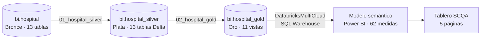

# Hospital Analytics — Tablero de gestión hospitalaria

Proyecto del curso **PG1054 – Fundamentos de Inteligencia de Negocios**.
Pipeline completo de BI: datos crudos en **Databricks** → arquitectura **medallón** (bronce, plata, oro) → modelo dimensional de **constelación** → tablero en **Power BI** con storytelling **SCQA**.

> **Pregunta de negocio:** ¿el hospital está aprovechando bien su capacidad de atención?
> **Tesis:** *un hospital grande que trabaja como uno pequeño.*

---

## 1. Arquitectura



| Capa | Ubicación | Objetos | Qué se hizo |
|---|---|---|---|
| Bronce | `bi.hospital` | 13 tablas | Datos originales (*Hospital Management System*, Kaggle) |
| Plata | `bi.hospital_silver` | 13 tablas Delta | Limpieza, tipificación, estandarización y deduplicación (`QUALIFY ROW_NUMBER`) |
| Oro | `bi.hospital_gold` | 11 vistas | Modelo de constelación: 4 hechos + 7 dimensiones con llaves sustitutas |

**Validaciones:** 0 diferencias de filas bronce vs. plata en las 13 tablas · 0 llaves huérfanas · 0 llaves duplicadas · recaudo bronce = oro = 1.663.354.

## 2. Modelo dimensional (constelación)

- **Hechos:** `fact_appointments` (cita), `fact_admissions` (estancia en cama o habitación), `fact_surgeries` (cirugía), `fact_medical_records` (consulta clínica).
- **Dimensiones:** `dim_patients`, `dim_doctors`, `dim_departments`, `dim_staff`, `dim_beds`, `dim_rooms`, `dim_date`.
- **23 relaciones** de dirección única (20 activas y 3 inactivas, que se activan con `USERELATIONSHIP` cuando una medida las necesita).

El diagrama interactivo del modelo está en [`docs/hospital_gold_constelacion_erd.html`](docs/hospital_gold_constelacion_erd.html). Para verlo, descárgalo y ábrelo en el navegador.

## 3. Tablero (storytelling SCQA)

| Página | Rol | Mensaje |
|---|---|---|
| **0 · Inventario** | Contexto | Capacidad instalada: 31 departamentos, 400 médicos, 500 camas, 391 habitaciones |
| **1 · Situación** | *Situation* | El hospital en cifras: 1.000 citas, recaudo 1.663.354, 2.000 estancias, 1.000 cirugías |
| **2 · Complicación** | *Complication* | Cuello de botella: 9 de 400 médicos con citas; uno concentra el 50,5 %; 10,2 % de inasistencia |
| **3 · Pregunta** | *Question* | ¿Cómo se usan camas y quirófanos? Estancia por pabellón y tipo de habitación, top 10 de cirugías |
| **4 · Respuesta** | *Answer* | 338 pacientes crónicos, 134 con presión alta y 72 hipertensos sin próxima cita; recomendaciones |

**Interacción:** el segmentador de Departamento está sincronizado en las 5 páginas, y los de Año y Trimestre en las páginas 1 a 4. El inventario no se filtra por tiempo porque es capacidad instalada.

**Diseño:** paleta *Azul clínico* sobre fondo blanco, con contraste WCAG AA. El rojo `#C0392B` queda reservado para alertas. El tema y los fondos están en [`docs/tema/`](docs/tema/) y se generan con `generar_fondos_y_tema.py`.

## 4. Medidas DAX destacadas

El modelo tiene 62 medidas en la tabla `_Medidas`, organizadas en carpetas por página. Algunas técnicas usadas:

| Técnica | Ejemplo |
|---|---|
| `DIVIDE` en lugar de `/` | `% No Asistió = DIVIDE ( SUM ( fact_appointments[is_no_show] ), [Total Citas] )` |
| Relación inactiva | `Egresos` usa `USERELATIONSHIP` sobre `discharge_date_key` |
| Relaciones virtuales | Medidas de inventario por departamento con `TREATAS` |
| Ranking dinámico | `Cirugías Top 10` con `RANKX ( ALLSELECTED (...) )` |
| Blank → 0 en tarjetas | `Cirugías (tarjeta) = COALESCE ( [Total Cirugías], 0 )` |

El catálogo completo, con la fórmula, el propósito y el valor esperado de cada medida, está en [`docs/Tablero_Hospital_Sustentacion.docx`](docs/Tablero_Hospital_Sustentacion.docx). El código fuente está en [`_Medidas.tmdl`](powerbi/Hospital_BI_PBIP.SemanticModel/definition/tables/_Medidas.tmdl).

## 5. Estructura del repositorio

```
├── databricks/
│   ├── 01_hospital_silver.ipynb     # Capa plata (limpieza)
│   ├── 02_hospital_gold.ipynb       # Capa oro (vistas del modelo dimensional)
│   └── hospital_silver_gold.sql     # Mismo código en un solo script SQL
├── powerbi/
│   ├── Hospital_BI_PBIP.pbip        # Abrir este archivo en Power BI Desktop
│   ├── Hospital_BI_PBIP.Report/     # Páginas y visuales (formato PBIR, JSON)
│   └── Hospital_BI_PBIP.SemanticModel/  # Tablas, relaciones y medidas (TMDL)
└── docs/
    ├── Tablero_Hospital_Sustentacion.docx
    ├── hospital_gold_constelacion_erd.html
    └── tema/                         # Tema JSON, fondos y generador
```

El reporte está en formato **PBIP** (proyecto de Power BI) y no en `.pbix`. Así cada página, visual y medida es un archivo de texto que GitHub puede mostrar y comparar entre versiones.

## 6. Cómo abrirlo

1. Ejecuta en Databricks `databricks/01_hospital_silver.ipynb` y luego `02_hospital_gold.ipynb`. Necesitas el catálogo `bi` con el esquema `hospital` cargado.
2. Abre `powerbi/Hospital_BI_PBIP.pbip` con Power BI Desktop. Debe estar activada la vista previa *Power BI Project (.pbip)*.
3. Ve a **Transformar datos → Configuración del origen de datos** y reemplaza `<DATABRICKS_HOST>` y `<WAREHOUSE_ID>` por los de tu SQL Warehouse. Por seguridad, el repositorio no publica el host real.
4. Pulsa **Actualizar**.

> El repositorio no incluye la caché de datos (`cache.abf`). Por eso, sin conexión a Databricks, los visuales aparecen vacíos.

## 7. Limitaciones y calidad del dato

- **Cobertura de fechas distinta por hecho:** cirugías 2022 T1–2025 T2; citas 2024 T3–2025 T2; estancias 2024 T4–2025 T2. Un filtro de año puede dejar páginas en cero.
- **Cirugías sin hora de inicio ni fin** en el origen: no se puede calcular la duración real del quirófano.
- **Geriatrics Ward** no tiene camas asociadas.
- **Lecturas de presión alta uniformes** (todas 150/95, *Essential Hypertension*), lo que indica que el dataset es sintético.
- **Citas canceladas con pago registrado:** el recaudo puede estar sobrestimado (ver la medida `Recaudo sin Atención`).

## 8. Trabajo futuro

- Orquestar plata → oro con un **Databricks Job** programado.
- Modelo de **machine learning para predecir inasistencia** a citas, a partir de `fact_appointments`.

---

**Herramientas:** Databricks (SQL, Delta Lake, Unity Catalog) · Power BI Desktop (PBIP, TMDL, DAX)
**Dataset:** *Hospital Management System* (Kaggle), datos sintéticos.
